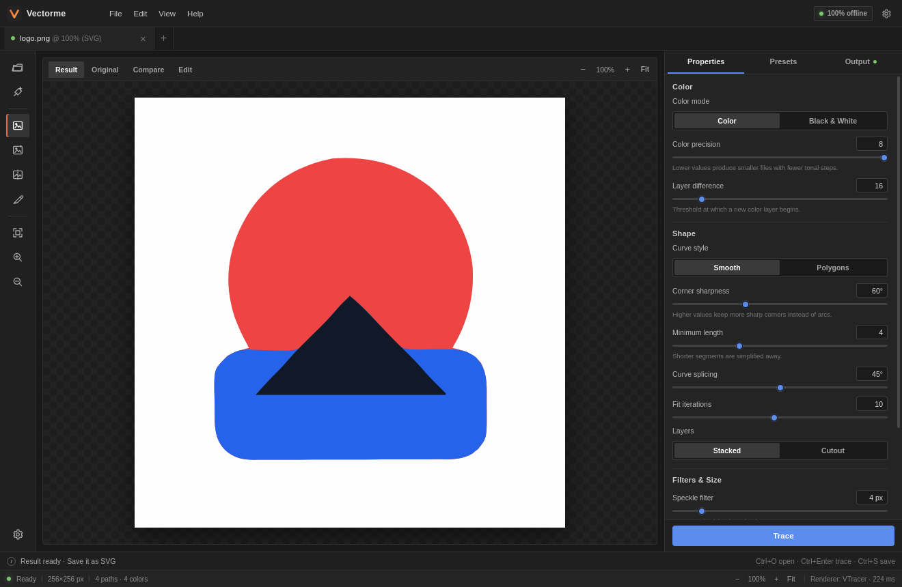
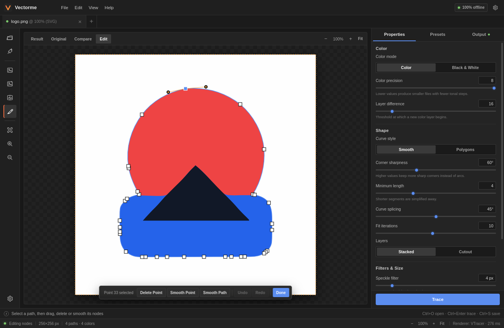
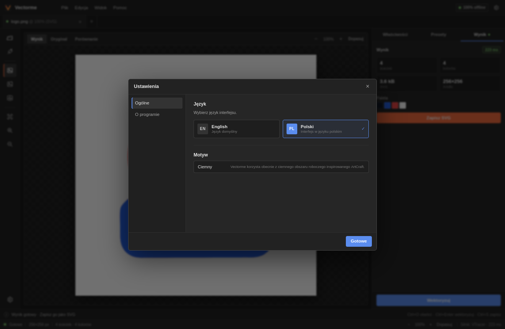

# Vectorme

**English** | [Polski](README.pl.md)

[](https://github.com/multicolor-rgb/vectorme/releases/latest)
[](LICENSE)
[](#download)
[](https://multicolor-rgb.github.io/vectorme/)

Vectorme is a local raster-to-SVG tracer for Linux and Windows. Load a PNG, JPEG or
WebP, tune the tracing settings, correct individual nodes, and export a clean,
scalable SVG. Everything runs on your machine: no cloud, no account, no telemetry.

The interface is inspired by the ArtCraft family: a top menu bar, a tool rail,
document tabs, a properties panel and a compact status bar.



## Download

Get the latest installers from the [releases page](https://github.com/multicolor-rgb/vectorme/releases/latest).

| Platform | Packages |
| --- | --- |
| Windows 10/11 (x64) | `.msi` installer, `-setup.exe` (NSIS) |
| Linux x86_64 | `.deb` (Debian/Ubuntu/Mint), `.AppImage` |

> The Windows installers are currently unsigned. Windows SmartScreen may show a
> warning; choose **More info → Run anyway** if you trust the build. You can also
> inspect the source and build the app yourself.

## Features

- PNG, JPEG, WebP, BMP, GIF and TIFF input.
- Color and black-and-white tracing.
- Presets for **Logo**, **Black & White** and **Photo**.
- Control over color precision, layer difference, smoothing, corner sharpness,
  curve splicing, fit iterations, speckle filtering and path precision.
- Result preview with zoom, pan and a before/after comparison slider.
- Preserve transparency or flatten the image onto white.
- Native SVG export with original image dimensions preserved.
- Statistics: path count, palette, tracing time and output size.
- **Node editor**: select a path, drag points and Bézier handles, delete a point,
  smooth a point or a whole path, and undo/redo changes.
- English interface by default; Polish is available in Settings.
- 100% offline and local.

## Node editor

After tracing, open the **Edit** tab in the preview toolbar or the pen icon in the
left tool rail. Click a path to reveal its nodes, then:

- drag white nodes to correct the shape,
- drag orange handles to adjust Bezier curves,
- **Delete Point** removes the selected node,
- **Smooth Point** smooths the selected node,
- **Smooth Path** smooths every node on the path,
- **Undo / Redo** move through the edit history,
- **Done** returns to the rendered SVG preview.

Shortcuts: `Del` deletes the selected point, `Ctrl+Z` undoes, `Ctrl+Shift+Z`
redoes, `Esc` clears the selection. When zoomed in, pan with `Alt` + drag or the
middle mouse button.



A closed path needs at least three points; the editor refuses to delete below that
limit. Undo history is local to the current editing session.

## Languages

The default language is **English**. To switch to Polish, open **Settings**
(`Ctrl+,`) and choose **Polski** under **Language**. The choice is stored locally.



## Install

### Windows

1. Download the `.msi` or `-setup.exe` from the latest release.
2. Run the installer.
3. Launch **Vectorme** from the Start menu.

Vectorme uses the system WebView2 runtime, which is preinstalled on Windows 10 and 11.
If it is missing, install the Microsoft Edge WebView2 Runtime.

### Linux

Debian, Ubuntu, Linux Mint:

```bash
sudo apt install ./Vectorme_0.1.0_amd64.deb
```

AppImage:

```bash
chmod +x Vectorme_0.1.0_amd64.AppImage
./Vectorme_0.1.0_amd64.AppImage
```

If your system does not have FUSE:

```bash
./Vectorme_0.1.0_amd64.AppImage --appimage-extract-and-run
```

## Build from source

Requirements:

- Node.js 20+
- Rust 1.90+
- Tauri dependencies: `libwebkit2gtk-4.1-dev`, `libgtk-3-dev`,
  `libayatana-appindicator3-dev`, `librsvg2-dev`
- On Debian/Ubuntu/Mint:

```bash
sudo apt install libwebkit2gtk-4.1-dev libgtk-3-dev \
  libayatana-appindicator3-dev librsvg2-dev
```

```bash
npm install
npm run tauri dev
```

Build release bundles:

```bash
npm run tauri build
```

The output is written to `target/release/bundle/`.

Core tests and a small CLI tracer:

```bash
cargo test -p vectorme-core
cargo run -p vectorme-core --example trace -- image.png output.svg photo
```

## Architecture

```text
src/                     React + TypeScript UI, i18n and node editor
src-tauri/               Tauri 2 commands, dialogs and native file I/O
crates/vectorme-core/    decoding, preprocessing, VTracer engine and SVG output
docs/                    GitHub Pages landing page and screenshots
```

The tracing core is built around [VTracer](https://github.com/visioncortex/vtracer)
(MIT/Apache-2.0). It is isolated behind `trace_file`, so the engine can be replaced
or extended with a different color quantizer in the future. Warnings cross the Rust
boundary as machine-readable codes and are translated in the UI.

## Limitations

- This is not an exact clone of Vector Magic's proprietary algorithm. Logos and flat
  artwork trace very well; photos may produce larger, more posterized SVGs.
- VTracer does not accept an exact "number of colors"; use color precision and layer
  difference to control the palette.
- Soft semi-transparent pixels are simplified; fully transparent areas are preserved.
- Very large images are downscaled to the limit set in the properties panel.
- The node editor works on the Bezier paths generated by VTracer. It does not edit
  text, gradients or masks, because the engine does not generate them.
- Undo history is session-only and is not stored in the SVG.
- Windows installers are unsigned at the moment.

## License

MIT. See [LICENSE](LICENSE). "Vector Magic" is a trademark of its owner; Vectorme is an
independent project.
