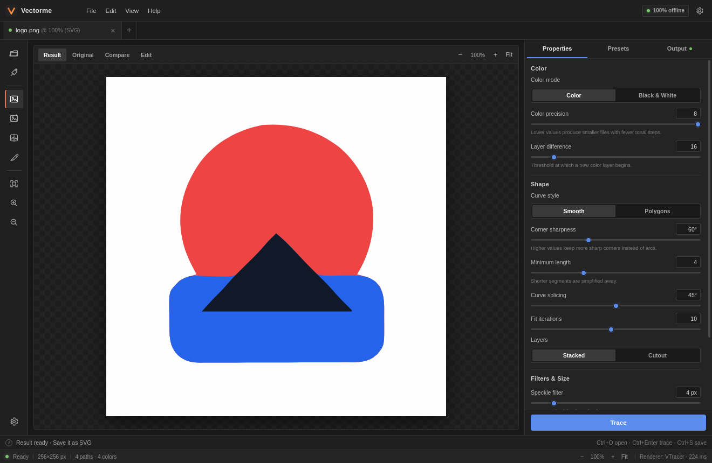
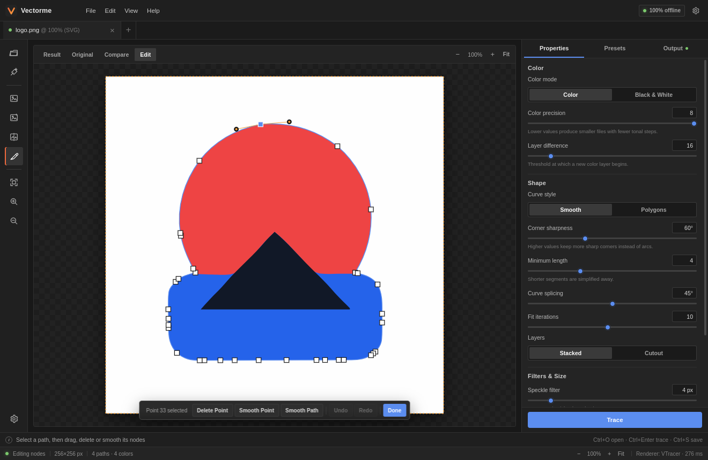
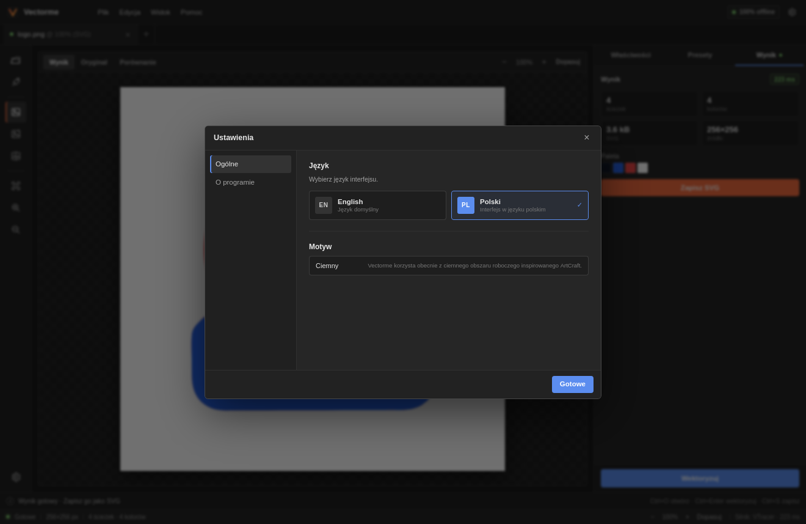

# Vectorme

[English](README.md) | **Polski**

[](https://github.com/multicolor-rgb/vectorme/releases/latest)
[](LICENSE)
[](#pobieranie)
[](https://multicolor-rgb.github.io/vectorme/)

Vectorme to lokalny tracer rastrowy do SVG dla Linuksa i Windowsa. Wczytaj PNG, JPEG
lub WebP, dopasuj ustawienia wektoryzacji, popraw pojedyncze węzły i zapisz czysty,
skalowalny plik SVG. Wszystko działa na Twoim komputerze: bez chmury, bez konta i bez
telemetrii.

Interfejs jest inspirowany pakietami ArtCraft: górne menu, szyna narzędzi, zakładki
dokumentu, panel właściwości i zwarty pasek statusu.



## Pobieranie

Najnowsze instalatory znajdziesz na [stronie wydań](https://github.com/multicolor-rgb/vectorme/releases/latest).

| Platforma | Paczki |
| --- | --- |
| Windows 10/11 (x64) | instalator `.msi`, `-setup.exe` (NSIS) |
| Linux x86_64 | `.deb` (Debian/Ubuntu/Mint), `.AppImage` |

> Instalatory Windows nie są obecnie podpisane. Windows SmartScreen może pokazać
> ostrzeżenie; wybierz **Więcej informacji → Uruchom mimo to**, jeśli ufasz buildowi.
> Kod źródłowy jest publiczny, więc możesz też zbudować aplikację samodzielnie.

## Funkcje

- Wejście PNG, JPEG, WebP, BMP, GIF i TIFF.
- Wektoryzacja kolorowa oraz czarno-biała.
- Presety **Logo**, **Black & White** i **Photo**.
- Kontrola precyzji kolorów, różnicy warstw, wygładzania, ostrości narożników,
  łączenia krzywych, iteracji dopasowania, filtra plamek i precyzji ścieżek.
- Podgląd wyniku z zoomem, panoramą i suwakiem porównania przed/po.
- Zachowanie przezroczystości lub spłaszczenie obrazu na białym tle.
- Natywny eksport SVG z zachowaniem oryginalnych wymiarów obrazu.
- Statystyki: liczba ścieżek, paleta, czas wektoryzacji i rozmiar pliku.
- **Edytor węzłów**: wybór ścieżki, przeciąganie punktów i uchwytów Béziera,
  usuwanie punktu, wygładzanie punktu lub całej ścieżki oraz undo/redo.
- Domyślnie angielski interfejs; polski jest dostępny w ustawieniach.
- 100% offline i lokalnie.

## Edytor węzłów

Po wektoryzacji otwórz zakładkę **Edit** w pasku podglądu albo ikonę pióra w lewej
szynie narzędzi. Kliknij ścieżkę, aby pokazać jej punkty, a następnie:

- przeciągaj białe punkty, aby korygować kształt,
- przeciągaj pomarańczowe uchwyty, aby zmieniać krzywe Béziera,
- **Delete Point** usuwa wybrany punkt,
- **Smooth Point** wygładza wybrany punkt,
- **Smooth Path** wygładza wszystkie punkty ścieżki,
- **Undo / Redo** cofa i ponawia zmiany,
- **Done** wraca do podglądu wynikowego SVG.

Skróty: `Del` usuwa punkt, `Ctrl+Z` cofa, `Ctrl+Shift+Z` ponawia, `Esc` odznacza.
Przy powiększeniu przesuwaj widok przez `Alt` + przeciąganie lub środkowy przycisk
myszy.



Zamknięta ścieżka wymaga co najmniej trzech punktów; edytor nie pozwoli usunąć
poniżej tego limitu. Historia undo jest lokalna dla danej sesji edycji.

## Języki

Domyślnym językiem jest **English**. Aby przełączyć na polski, otwórz **Ustawienia**
(`Ctrl+,`) i wybierz **Polski** w sekcji **Język**. Wybór jest zapamiętywany lokalnie.



## Instalacja

### Windows

1. Pobierz `.msi` lub `-setup.exe` z najnowszego wydania.
2. Uruchom instalator.
3. Uruchom **Vectorme** z menu Start.

Vectorme korzysta z systemowego WebView2, który jest zwykle zainstalowany w Windows 10
i 11. Jeśli go brakuje, doinstaluj Microsoft Edge WebView2 Runtime.

### Linux

Debian, Ubuntu, Linux Mint:

```bash
sudo apt install ./Vectorme_0.1.0_amd64.deb
```

AppImage:

```bash
chmod +x Vectorme_0.1.0_amd64.AppImage
./Vectorme_0.1.0_amd64.AppImage
```

Jeśli system nie ma FUSE:

```bash
./Vectorme_0.1.0_amd64.AppImage --appimage-extract-and-run
```

## Budowanie ze źródeł

Wymagania:

- Node.js 20+
- Rust 1.90+
- biblioteki Tauri: `libwebkit2gtk-4.1-dev`, `libgtk-3-dev`,
  `libayatana-appindicator3-dev`, `librsvg2-dev`
- Na Debianie/Ubuntu/Mincie:

```bash
sudo apt install libwebkit2gtk-4.1-dev libgtk-3-dev \
  libayatana-appindicator3-dev librsvg2-dev
```

```bash
npm install
npm run tauri dev
```

Budowanie paczek:

```bash
npm run tauri build
```

Wynik trafia do `target/release/bundle/`.

Testy rdzenia i mały tracer CLI:

```bash
cargo test -p vectorme-core
cargo run -p vectorme-core --example trace -- obraz.png wynik.svg photo
```

## Architektura

```text
src/                     React + TypeScript, i18n i edytor węzłów
src-tauri/               komendy Tauri 2, dialogi i natywne I/O
crates/vectorme-core/    dekodowanie, preprocessing, VTracer i SVG
docs/                    landing page GitHub Pages i zrzuty ekranu
```

Rdzeń opiera się na [VTracer](https://github.com/visioncortex/vtracer)
(MIT/Apache-2.0). Jest odseparowany interfejsem `trace_file`, więc silnik można w
przyszłości wymienić lub uzupełnić własną kwantyzacją kolorów. Ostrzeżenia przechodzą
przez granicę Rust/UI jako kody i są tłumaczone w interfejsie.

## Ograniczenia

- To nie jest dokładny klon algorytmu Vector Magic. Logotypy i grafika płaska wychodzą
  bardzo dobrze; zdjęcia mogą dawać większe i bardziej posterowane SVG.
- VTracer nie przyjmuje dokładnej „liczby kolorów”; paletę kontroluje się precyzją
  kolorów i różnicą warstw.
- Miękkie, półprzezroczyste piksele są upraszczane; pełna przezroczystość jest zachowana.
- Bardzo duże obrazy są zmniejszane do limitu ustawionego w panelu właściwości.
- Edytor węzłów obsługuje ścieżki Béziera wygenerowane przez VTracer. Nie edytuje
  tekstu, gradientów ani masek, ponieważ silnik ich nie generuje.
- Historia undo jest pamiętana tylko w danej sesji edycji i nie trafia do SVG.
- Instalatory Windows nie są obecnie podpisane.

## Licencja

MIT. Szczegóły w [LICENSE](LICENSE). „Vector Magic” jest znakiem towarowym jego
właściciela; Vectorme jest niezależnym projektem.
